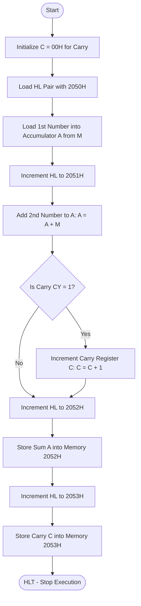

# MPMC Assignment 2 — Comprehensive Solutions & Technical Notes

> **Course**: Microprocessor and Microcontroller (PCCS4308)  
> **Programme**: B.Tech Computer Science & Engineering — 5th Semester  
> **Department**: Computer Science Engineering & Applications, IGIT Sarang  
> **Examination**: 1st Terminal Examination 2026 (Module 1 — 8085 Microprocessor)  
> **Source Question Paper**: [[MPMC assignment-2|MPMC Assignment 2 Questions]] | [[MPMC_2026_Internal-1|Internal 1 Question Paper Image]]  
> **References**: Mr. Suvendu Kumar Jena (SKJ) Lecture Notes; Ramesh S. Gaonkar (*Microprocessor Architecture, Programming & Applications with 8085*)

---

# Question 1: Short Answer Questions (1 Mark Each)

---

### 1.a: What is the function of the ALE (Address Latch Enable) signal in 8085?

#### **Answer:**
The **ALE (Address Latch Enable)** signal (Pin 30) is an active-high, positive-going pulse generated by the 8085 microprocessor during the first clock state ($T_1$) of every machine cycle.

#### **Core Functions:**
1. **Bus Demultiplexing**: In the 8085, the lower 8 address lines ($A_0 - A_7$) are time-multiplexed with the 8 data lines ($D_0 - D_7$) on pins $AD_0 - AD_7$ to conserve pin count on the 40-pin IC package.
2. **Latching Address**: When ALE goes **HIGH**, it signals that the bits on $AD_0 - AD_7$ represent the lower-order memory or I/O address.
3. **External Latch Trigger**: On the high-to-low falling edge of ALE, an external transparent octal latch (such as IC 74LS373 or Intel 8212) captures and holds the address $A_0 - A_7$ stable for the remainder of the machine cycle ($T_2, T_3, T_4$). During $T_2$ and $T_3$, the $AD_0 - AD_7$ lines are free to function as the bidirectional data bus ($D_0 - D_7$).

```
        8085 Microprocessor                      74LS373 Octal Latch
       +--------------------+                   +--------------------+
       |                    |                   |                    |
       |            ALE (30)|------------------>| G (Latch Enable)   |
       |                    |                   |                    |
       |     AD0 - AD7 (12-19)|================>| D0 - D7            |
       |                    |                   |                    |
       |                    |                   |  OE = GND          |
       +--------------------+                   +----+---------------+
                 |                                   |
                 | (During T2-T4: Data Bus D0-D7)     | (Stable A0-A7 throughout cycle)
                 v                                   v
             [Data Bus]                        [Lower Address Bus]
```

---

### 1.b: What is the purpose of the Program Counter (PC) in 8085?

#### **Answer:**
The **Program Counter (PC)** is a **16-bit special-purpose register** in the 8085 architecture used for sequential instruction sequencing and control transfer.

#### **Key Purposes:**
1. **Instruction Pointer**: It holds the 16-bit memory address of the *next instruction byte* to be fetched from memory for execution.
2. **Auto-Increment**: As each instruction byte is fetched during the Opcode Fetch or Memory Read machine cycles, the internal 16-bit Incrementer/Decrementer automatically increments the PC ($\text{PC} \leftarrow \text{PC} + 1$).
3. **Branching & Calls**: During branch instructions (`JMP`, `CALL`, `RET`, `RST`), the PC is updated with the target branch address, redirecting program execution.
4. **Reset State**: When the microprocessor is reset via $\overline{\text{RESET IN}}$, the Program Counter is automatically initialized to `0000H`, forcing the 8085 to fetch its very first instruction from memory address `0000H`.

---

### 1.c: Define I/O mapped I/O addressing.

#### **Answer:**
**I/O Mapped I/O** (also known as **Isolated I/O** or **Standard I/O**) is an interfacing method where the I/O devices (input/output ports) are addressed within an independent, isolated 8-bit address space, distinct from the system memory.

#### **Key Characteristics:**
- **Address Space**: Uses an **8-bit device address** (port number), providing an addressing capacity of $2^8 = 256$ input ports and $256$ output ports (range `00H` to `FFH`).
- **Bus Duplication**: During I/O cycles, the 8-bit port address is duplicated onto both higher-order address lines ($A_{15}-A_8$) and lower-order address lines ($A_7-A_0$).
- **Control Signal**: The status pin $IO/\overline{M}$ is set to **Logic 1 (HIGH)**, indicating an I/O operation. Operations use the control signals $\overline{\text{IOR}}$ (I/O Read) and $\overline{\text{IOW}}$ (I/O Write).
- **Dedicated Instructions**: Data transfer is strictly between the Accumulator (Register A) and I/O devices via only two assembly instructions:
  - `IN port-address` (e.g., `IN 80H`)
  - `OUT port-address` (e.g., `OUT 82H`)
- **Memory Conservation**: It does not consume any space from the 64 KB memory map.

---

### 1.d: What is the function of the Stack Pointer (SP) in 8085?

#### **Answer:**
The **Stack Pointer (SP)** is a **16-bit special-purpose register** that stores the memory address of the current **Top of the Stack (TOS)** located in read/write (RAM) memory.

#### **Key Functions & Mechanics:**
- **LIFO Data Structure**: The stack operates on a **Last-In, First-Out** basis and grows **downwards** (from higher memory addresses to lower memory addresses).
- **Push / Subroutine Call (`PUSH`, `CALL`)**:
  - Before writing data onto the stack, the SP is decremented.
  - Higher-order byte stored at `SP - 1`, lower-order byte at `SP - 2`, and `SP` is updated to `SP - 2`.
- **Pop / Return (`POP`, `RET`)**:
  - Data is read from the current SP location (lower-order byte from `SP`, higher-order byte from `SP + 1`).
  - SP is incremented by 2 (`SP` $\leftarrow$ `SP + 2`).
- **Initialization**: Software initializes SP at the beginning of a program (typically pointing to the end of available RAM, e.g., `LXI SP, 20FFH` or `LXI SP, FFFFH`).

---

### 1.e: Name any two hardware interrupts of the 8085 microprocessor.

#### **Answer:**
The 8085 microprocessor has 5 dedicated hardware interrupt pins. Any two of the following are valid:

1. **TRAP** (Highest priority, non-maskable, both level- and edge-sensitive, vectored at address `0024H`).
2. **RST 7.5** (Second highest priority, maskable, rising edge-sensitive, vectored at address `003CH`).

*(Other hardware interrupts include **RST 6.5** at `0034H`, **RST 5.5** at `002CH`, and **INTR** which is non-vectored).*

---
---

# Question 2: Architecture & Execution Cycle (5 Marks Each)

---

### 2.a: Explain the architecture of 8085 microprocessor with a neat block diagram. Discuss its major registers and functional units.

#### **1. Architectural Overview**
The Intel 8085 is an 8-bit NMOS microprocessor packaged in a 40-pin Dual In-line Package (DIP). It operates with a internal clock frequency of 3 MHz (driven by an external 6 MHz crystal across $X_1$ and $X_2$) and requires a single $+5\text{V}$ power supply. It possesses a 16-bit address bus capable of directly accessing $2^{16} = 64\text{ KB}$ of memory and an 8-bit multiplexed address/data bus ($AD_0 - AD_7$).

#### **2. Architecture Block Diagram**

```mermaid
graph TB
    subgraph "Interrupt & Serial Control"
        INT[Interrupt Control<br>TRAP, RST7.5, RST6.5, RST5.5, INTR, INTA']
        SIO[Serial I/O Control<br>SID, SOD]
    end

    subgraph "ALU Unit"
        ACC[Accumulator Register A<br>8-bit]
        TEMP_REG[Temp Register<br>8-bit]
        ALU[Arithmetic & Logic Unit<br>ALU - 8-bit]
        FLAG[Flag Register<br>5 Flags: S, Z, AC, P, CY]
        
        ACC --> ALU
        TEMP_REG --> ALU
        ALU --> ACC
        ALU --> FLAG
    end

    subgraph "Instruction Unit"
        IR[Instruction Register<br>8-bit]
        ID[Instruction Decoder &<br>Machine Cycle Encoder]
        IR --> ID
    end

    subgraph "Timing & Control Unit"
        TC[Timing & Control<br>CLK OUT, X1, X2<br>ALE, RD', WR', IO/M'<br>S0, S1, READY, RESET]
        ID --> TC
    end

    subgraph "Register Array"
        W_Z["W (8-bit) | Z (8-bit)<br>(Temporary Registers - Internal)"]
        B_C["B (8-bit) | C (8-bit)"]
        D_E["D (8-bit) | E (8-bit)"]
        H_L["H (8-bit) | L (8-bit) (Memory Pointer M)"]
        SP_REG["Stack Pointer SP (16-bit)"]
        PC_REG["Program Counter PC (16-bit)"]
        INC_DEC["Incrementer / Decrementer Address Latch (16-bit)"]
    end

    subgraph "Bus Buffers"
        ADDR_BUF["Address Buffer<br>(Pins A15 - A8)<br>Unidirectional"]
        ADDR_DATA_BUF["Address / Data Buffer<br>(Pins AD7 - AD0)<br>Bidirectional"]
    end

    BUS((Internal 8-bit Data Bus))

    INT <--> BUS
    SIO <--> BUS
    ACC <--> BUS
    FLAG <--> BUS
    TEMP_REG <--> BUS
    IR <-- BUS
    W_Z <--> BUS
    B_C <--> BUS
    D_E <--> BUS
    H_L <--> BUS
    SP_REG <--> BUS
    PC_REG <--> BUS
    INC_DEC --> ADDR_BUF
    INC_DEC --> ADDR_DATA_BUF
```

---

#### **3. Major Registers of 8085**

1. **Accumulator (Register A)**:
   - An 8-bit register that serves as the primary working register for all ALU operations.
   - Holds one of the operands prior to an arithmetic or logical operation and receives the final 8-bit result. It also acts as the source/destination for I/O operations (`IN`/`OUT`).

2. **General-Purpose Registers (B, C, D, E, H, L)**:
   - Six 8-bit registers used by the programmer to store temporary data during program execution.
   - Can be used individually as 8-bit registers or combined into **16-bit register pairs**:
     - **BC pair**: General 16-bit storage/counter.
     - **DE pair**: General 16-bit storage.
     - **HL pair**: Operates as the **Memory Pointer ($M$)**. When instructions reference operand $M$ (e.g., `MOV A, M`), the 16-bit contents of $H$ (higher byte) and $L$ (lower byte) form the physical memory address.

3. **Temporary Registers (W and Z)**:
   - Two internal 8-bit registers used strictly by the microprocessor control unit during the execution of multi-byte instructions (e.g., storing address bytes during `CALL`, `XCHG`, or `JMP`).
   - Not accessible or programmable by the user.

4. **Flag Register (Status Register)**:
   - An 8-bit register containing 5 individual 1-bit flip-flops reflecting the status of the ALU after arithmetic and logic operations:

```
    D7    D6    D5    D4    D3    D2    D1    D0
  +-----+-----+-----+-----+-----+-----+-----+-----+
  |  S  |  Z  |  X  | AC  |  X  |  P  |  X  | CY  |
  +-----+-----+-----+-----+-----+-----+-----+-----+
  (X = Undefined / Don't Care)
```

   - **Sign Flag (S)**: Set to 1 if bit $D_7$ of the result is 1 (negative number in 2's complement); reset to 0 if positive.
   - **Zero Flag (Z)**: Set to 1 if the ALU result is strictly zero (`00H`); reset to 0 otherwise.
   - **Auxiliary Carry Flag (AC)**: Set to 1 if an arithmetic carry is generated from bit $D_3$ to bit $D_4$ during addition (used in BCD operations with `DAA`).
   - **Parity Flag (P)**: Set to 1 if the result contains an **even** number of 1-bits (Even Parity); reset to 0 for odd parity.
   - **Carry Flag (CY)**: Set to 1 if an arithmetic addition generates a final carry out of bit $D_7$, or if subtraction requires a borrow; reset to 0 otherwise.

5. **Program Counter (PC)**:
   - A 16-bit register that stores the memory address of the next instruction byte to be fetched. Automatically incremented after each fetch.

6. **Stack Pointer (SP)**:
   - A 16-bit register pointing to the top of the stack located in RAM. Decremented on `PUSH`/`CALL` and incremented on `POP`/`RET`.

---

#### **4. Functional Units of 8085**

1. **Arithmetic and Logic Unit (ALU)**:
   - Performs 8-bit arithmetic additions, subtractions, increment, decrement, and logical operations (AND, OR, XOR, NOT, rotate, compare).
   - Inputs are received from the Accumulator and the 8-bit Temporary Register; results are routed to the Accumulator, and status flags are updated in the Flag Register.

2. **Instruction Register & Instruction Decoder**:
   - **Instruction Register (IR)**: Holds the 8-bit opcode fetched from memory during the Opcode Fetch machine cycle.
   - **Instruction Decoder & Machine Cycle Encoder**: Decodes the bit patterns of the opcode and establishes the exact sequence of micro-operations and machine cycles required for execution.

3. **Timing and Control Unit**:
   - The central brain that synchronizes all microprocessor activities with the clock.
   - **Clock Signals**: $X_1, X_2$ (crystal pins), $\text{CLK OUT}$.
   - **Control Signals**: $\overline{\text{RD}}$ (Read), $\overline{\text{WR}}$ (Write), $\text{ALE}$ (Address Latch Enable).
   - **Status Signals**: $IO/\overline{M}$, $S_0, S_1$ (identify machine cycle type).
   - **DMA Signals**: $\text{HOLD}$ (request from DMA controller) and $\text{HLDA}$ (Hold Acknowledge).
   - **Reset Signals**: $\overline{\text{RESET IN}}$ and $\text{RESET OUT}$.
   - **Wait State**: $\text{READY}$ (synchronizes CPU with slow memories/peripherals).

4. **Interrupt Control Unit**:
   - Manages asynchronous external service requests arriving on pins `TRAP`, `RST 7.5`, `RST 6.5`, `RST 5.5`, and `INTR`, and outputs the interrupt acknowledge signal $\overline{\text{INTA}}$.

5. **Serial I/O Control**:
   - Provides on-chip 1-bit serial communication via `SID` (Serial Input Data) and `SOD` (Serial Output Data), controlled through software via `RIM` and `SIM` instructions.

---

### 2.b: Explain the instruction execution cycle of 8085 and describe the different machine cycles with suitable timing diagrams.

#### **1. Instruction Execution Cycle Foundations**

- **Instruction Cycle (IC)**: The complete time required by the microprocessor to fetch an instruction from memory, decode its opcode, and execute the required operation.
- **Machine Cycle (MC)**: The basic unit of time during which the microprocessor accesses memory or an external I/O device. An instruction cycle is composed of **1 to 5 machine cycles** ($M_1, M_2, \dots, M_5$).
- **T-State (Clock Period)**: The smallest fundamental timing step of the microprocessor, equal to one complete cycle of the internal system clock:
  $$T = \frac{1}{f_{\text{CLK}}}$$
  For a 3 MHz clock, $1\text{ T-state} = \frac{1}{3 \times 10^6} \approx 333.3\text{ ns}$.
- **Mathematical Relationship**:
  $$\text{Instruction Cycle} = \sum_{k=1}^{n} \text{Machine Cycle}_k = \sum \text{T-states} \times T$$

```
Instruction Cycle
+-------------------------------------------------------------------------------+
|     Machine Cycle 1 (M1)      |    Machine Cycle 2 (M2)   |     ...           |
|         Opcode Fetch          |        Memory Read        |                   |
+-------------------------------+---------------------------+-------------------+
| T1  |  T2   |  T3   |  T4     |  T1   |  T2   |  T3       |                   |
+-------------------------------+---------------------------+-------------------+
```

---

#### **2. Classification and Status Table of 8085 Machine Cycles**

The 8085 generates status signals $IO/\overline{M}$, $S_1$, and $S_0$ at the start of every machine cycle to indicate the nature of the upcoming bus transaction:

| Machine Cycle | $IO/\overline{M}$ | $S_1$ | $S_0$ | Active Control Signal | T-States | Purpose |
| :--- | :---: | :---: | :---: | :---: | :---: | :--- |
| **Opcode Fetch ($M_1$)** | 0 | 1 | 1 | $\overline{\text{RD}} = 0$ | 4 T (or 6 T) | Fetch opcode from memory and decode inside CPU |
| **Memory Read** | 0 | 1 | 0 | $\overline{\text{RD}} = 0$ | 3 T | Read data or operand from memory location |
| **Memory Write** | 0 | 0 | 1 | $\overline{\text{WR}} = 0$ | 3 T | Write accumulator or register byte to memory |
| **I/O Read** | 1 | 1 | 0 | $\overline{\text{RD}} = 0$ | 3 T | Read data byte from input port |
| **I/O Write** | 1 | 0 | 1 | $\overline{\text{WR}} = 0$ | 3 T | Write byte from accumulator to output port |
| **Interrupt Acknowledge** | 1 | 1 | 1 | $\overline{\text{INTA}} = 0$ | 6 T or 12 T | Acknowledge interrupt & fetch vector instruction |
| **Bus Idle** | 0 / 1 | 0 | 0 | None ($\overline{\text{RD}}=\overline{\text{WR}}=1$) | 3 T | Internal CPU operations (e.g. `DAD`, `DCX`) |

---

#### **3. Detailed Machine Cycles and Timing Diagrams**

##### **(A) Opcode Fetch Machine Cycle ($M_1$ — 4 T-States)**
Every instruction begins with an Opcode Fetch machine cycle. It requires 4 T-states ($T_1 - T_4$):
- **$T_1$**:
  - Higher-order address ($A_{15} - A_8$) sent from Program Counter.
  - Lower-order address ($AD_7 - AD_0$) sent from Program Counter.
  - **ALE pulses HIGH**: Enables external latch 74LS373. On ALE's falling edge, $A_7 - A_0$ is latched.
  - Status lines set: $IO/\overline{M} = 0, S_1 = 1, S_0 = 1$.
- **$T_2$**:
  - Lower address lines $AD_7 - AD_0$ enter high-impedance ($Z$) state.
  - $\overline{\text{RD}}$ goes **LOW** (active). Memory is enabled to read.
- **$T_3$**:
  - Memory outputs opcode byte onto data bus ($AD_7 - AD_0$).
  - 8085 reads the opcode into Instruction Register (IR).
  - $\overline{\text{RD}}$ returns **HIGH**. Program counter increments ($\text{PC} \leftarrow \text{PC} + 1$).
- **$T_4$**:
  - Instruction Decoder decodes the opcode. Bus lines are idle.

```
Signal Waveforms for Opcode Fetch Cycle (M1):

        |<------- T1 ------->|<------- T2 ------->|<------- T3 ------->|<------- T4 ------->|
CLK     |   __        __     |   __        __     |   __        __     |   __        __     |
        |__/  \______/  \____|__/  \______/  \____|__/  \______/  \____|__/  \______/  \____|

A15-A8  |====== Higher Byte of Address (PC_H) =============================================|

AD7-AD0 |=== Lower Byte ====<--------------- Opcode from Memory --------------->| Float/Idle |
        |     (PC_L)        |                                                    |            |

ALE     |______/\____________|________________________________________________________________|

RD'     |---------------------\________________________________________/----------------------|

WR'     |-------------------------------------------------------------------------------------| (High throughout)

IO/M'   |_____________________________________________________________________________________| (Low = Memory)
S1, S0  |====== S1 = 1, S0 = 1 (Opcode Fetch Status) ========================================|
```

---

##### **(B) Memory Read Machine Cycle (3 T-States: $T_1 - T_3$)**
Used to fetch 8-bit immediate data, address bytes, or memory operands.
- **$T_1$**: Memory address sent on $A_{15}-A_8$ and $AD_7-AD_0$. ALE pulses high to latch address. Status set to $IO/\overline{M} = 0, S_1 = 1, S_0 = 0$.
- **$T_2$**: $\overline{\text{RD}}$ goes **LOW**. Memory places data onto $AD_7-AD_0$.
- **$T_3$**: 8085 reads data byte into target register/internal latch. $\overline{\text{RD}}$ goes **HIGH**.

```
Signal Waveforms for Memory Read Cycle:

        |<------- T1 ------->|<------- T2 ------->|<------- T3 ------->|
CLK     |   __        __     |   __        __     |   __        __     |
        |__/  \______/  \____|__/  \______/  \____|__/  \______/  \____|

A15-A8  |====== Higher Byte of Memory Address =========================|

AD7-AD0 |=== Lower Byte ====<---------- Data Byte from Memory -------->|
        |     Address       |                                          |

ALE     |______/\____________|__________________________________________|

RD'     |---------------------\________________________________________/|

WR'     |--------------------------------------------------------------| (High throughout)

IO/M'   |______________________________________________________________| (Low = Memory)
S1, S0  |====== S1 = 1, S0 = 0 (Memory Read Status) ===================|
```

---

##### **(C) Memory Write Machine Cycle (3 T-States: $T_1 - T_3$)**
Used to store accumulator/register data into external memory (e.g., `MOV M, A` or `STA addr`).
- **$T_1$**: Memory address sent on $A_{15}-A_8$ and $AD_7-AD_0$. ALE pulses high. Status set to $IO/\overline{M} = 0, S_1 = 0, S_0 = 1$.
- **$T_2$**: 8085 places data to be written onto $AD_7-AD_0$. $\overline{\text{WR}}$ goes **LOW** (active).
- **$T_3$**: External memory writes the byte while $\overline{\text{WR}}$ is low. $\overline{\text{WR}}$ goes **HIGH** to complete write. Data bus floats.

```
Signal Waveforms for Memory Write Cycle:

        |<------- T1 ------->|<------- T2 ------->|<------- T3 ------->|
CLK     |   __        __     |   __        __     |   __        __     |
        |__/  \______/  \____|__/  \______/  \____|__/  \______/  \____|

A15-A8  |====== Higher Byte of Memory Address =========================|

AD7-AD0 |=== Lower Byte ====<---------- Data Written by 8085 --------->|
        |     Address       |                                          |

ALE     |______/\____________|__________________________________________|

RD'     |--------------------------------------------------------------| (High throughout)

WR'     |---------------------\________________________________________/|

IO/M'   |______________________________________________________________| (Low = Memory)
S1, S0  |====== S1 = 0, S0 = 1 (Memory Write Status) ==================|
```

---
---

# Question 3: Assembly Programming & Timing Diagram (5 Marks Each)

---

### 3.a: Write an 8085 assembly language program to add two 8-bit numbers and explain the instructions used.

#### **1. Problem Specification**
- **First 8-bit number**: Stored in memory location `2050H`.
- **Second 8-bit number**: Stored in memory location `2051H`.
- **Result Output**:
  - **8-bit Sum**: Stored at memory location `2052H`.
  - **Carry (00H or 01H)**: Stored at memory location `2053H`.

---

#### **2. Program Algorithm & Flowchart**



---

#### **3. Assembly Language Program Code Table**

| Memory Address | Machine Code (Hex) | Labels | Mnemonic & Operands | Bytes | T-States | Detailed Comments |
| :---: | :---: | :--- | :--- | :---: | :---: | :--- |
| `2000H` | `0E 00` | | `MVI C, 00H` | 2 | 7 | Clear register C to 00H to track carry |
| `2002H` | `21 50 20` | | `LXI H, 2050H` | 3 | 10 | Point HL register pair to first number (`2050H`) |
| `2005H` | `7E` | | `MOV A, M` | 1 | 7 | Load first number from memory `M` into Accumulator |
| `2006H` | `23` | | `INX H` | 1 | 6 | Increment HL pair to point to second number (`2051H`) |
| `2007H` | `86` | | `ADD M` | 1 | 7 | Add second number in `M` to Accumulator ($A \leftarrow A + M$) |
| `2008H` | `D2 0C 20` | | `JNC NOCARRY` | 3 | 10/7 | If Carry Flag $CY = 0$, jump past carry increment |
| `200BH` | `0C` | | `INR C` | 1 | 4 | If $CY = 1$, increment Carry register ($C \leftarrow C + 1$) |
| `200CH` | `23` | `NOCARRY:` | `INX H` | 1 | 6 | Increment HL pointer to destination `2052H` |
| `200DH` | `77` | | `MOV M, A` | 1 | 7 | Store 8-bit Sum from Accumulator into `2052H` |
| `200EH` | `23` | | `INX H` | 1 | 6 | Increment HL pointer to destination `2053H` |
| `200FH` | `71` | | `MOV M, C` | 1 | 7 | Store Carry from register C into `2053H` |
| `2010H` | `76` | | `HLT` | 1 | 5 | Halt microprocessor execution |

---

#### **4. Detailed Explanation of Instructions Used**

1. **`MVI C, 00H` (Move Immediate)**:
   - **Addressing Mode**: Immediate addressing mode.
   - **Function**: Loads the 8-bit immediate data (`00H`) into general-purpose register $C$.
   - **Flags**: No flags are affected.

2. **`LXI H, 2050H` (Load Register Pair Immediate)**:
   - **Addressing Mode**: Immediate addressing mode.
   - **Function**: Loads the 16-bit constant address `2050H` directly into the $HL$ register pair ($H \leftarrow 20\text{H}, L \leftarrow 50\text{H}$).
   - **Flags**: No flags are affected.

3. **`MOV A, M` (Move from Memory to Register)**:
   - **Addressing Mode**: Register Indirect addressing mode.
   - **Function**: Copies the byte stored in memory at the address currently pointed to by the $HL$ register pair ($2050\text{H}$) into the Accumulator.
   - **Flags**: No flags are affected.

4. **`INX H` (Increment Register Pair)**:
   - **Addressing Mode**: Register addressing mode.
   - **Function**: Adds 1 to the 16-bit contents of the $HL$ register pair ($HL \leftarrow HL + 1$).
   - **Critical Invariant**: **`INX` does NOT modify ANY status flags** (unlike `INR`). This allows address pointers to be moved without corrupting the Carry flag.

5. **`ADD M` (Add Memory to Accumulator)**:
   - **Addressing Mode**: Register Indirect addressing mode.
   - **Function**: Adds the 8-bit contents of memory location pointed to by $HL$ ($2051\text{H}$) to the Accumulator:
     $$A \leftarrow A + [HL]$$
   - **Flags Affected**: **All condition flags (CY, AC, S, Z, P) are modified** based on the result. If the addition exceeds `FFH` ($255_{10}$), the Carry flag $CY$ is set to 1.

6. **`JNC NOCARRY` (Jump on No Carry)**:
   - **Addressing Mode**: Immediate / Absolute addressing mode.
   - **Function**: Tests the condition of the Carry Flag ($CY$). If $CY = 0$ (no carry generated), the Program Counter is loaded with the 16-bit branch address `200CH` (`NOCARRY`). If $CY = 1$, execution falls through to the next sequential instruction (`INR C`).
   - **Flags**: No flags are affected.

7. **`INR C` (Increment Register)**:
   - **Addressing Mode**: Register addressing mode.
   - **Function**: Increments the 8-bit register $C$ by 1 ($C \leftarrow C + 1$).
   - **Flag Note**: Affects $S, Z, AC, P$ flags, but **leaves the Carry flag ($CY$) unaffected**.

8. **`MOV M, A` / `MOV M, C` (Move from Register to Memory)**:
   - **Addressing Mode**: Register Indirect addressing mode.
   - **Function**: Writes the byte from the source register ($A$ or $C$) into the memory location addressed by the $HL$ pair.
   - **Flags**: No flags are affected.

9. **`HLT` (Halt)**:
   - **Addressing Mode**: Implicit / Inherent addressing mode.
   - **Function**: Stops instruction fetching and places the microprocessor buses into a quiescent state until an interrupt or reset occurs.

---

#### **5. Execution Trace with Test Data**
- **Inputs**:
  - Memory `2050H` = `98H` ($1001\ 1000_2$)
  - Memory `2051H` = `89H` ($1000\ 1001_2$)
- **ALU Addition**:
  $$\begin{array}{r@{\quad}l}
    1001\ 1000_2 & (98\text{H}) \\
  +\ 1000\ 1001_2 & (89\text{H}) \\
  \hline
   \mathbf{1}\ 0010\ 0001_2 & (121\text{H} \implies \text{Sum} = 21\text{H},\ \text{Carry} = 1)
  \end{array}$$
- **Outputs**:
  - Memory `2052H` (Sum) = `21H`
  - Memory `2053H` (Carry) = `01H`
  - Status Flags: $CY = 1, AC = 1, Z = 0, S = 0, P = 0$.

---

### 3.b: Draw and explain the timing diagram of MVI A, 25H instruction of 8085.

#### **1. Instruction Analysis**
- **Instruction**: `MVI A, 25H` (Move Immediate byte `25H` into Accumulator).
- **Opcode**: `3EH` (Machine code for `MVI A`).
- **Operand**: `25H` (Immediate 8-bit data).
- **Instruction Size**: 2 Bytes.
  - Byte 1 (`3EH`): Stored at address `2000H` (Opcode).
  - Byte 2 (`25H`): Stored at address `2001H` (Operand data).
- **Machine Cycles**: **2 Machine Cycles**:
  1. **$M_1$ (Opcode Fetch)**: 4 T-states ($T_1, T_2, T_3, T_4$).
  2. **$M_2$ (Memory Read)**: 3 T-states ($T_5, T_6, T_7$).
- **Total T-States**: $4 + 3 = 7\text{ T-States}$.
- **Total Execution Time**: At 3 MHz ($T = 333.3\text{ ns}$):
  $$\text{Execution Time} = 7 \times 333.3\text{ ns} \approx 2.33\ \mu\text{s}$$

---

#### **2. Step-by-Step T-State Breakdown**

##### **Machine Cycle 1: Opcode Fetch ($M_1$ — $T_1$ to $T_4$)**
- **$T_1$ (Address Output & Latch)**:
  - Higher-order address byte `20H` is placed on $A_{15} - A_8$.
  - Lower-order address byte `00H` is placed on multiplexed lines $AD_7 - AD_0$.
  - **ALE goes HIGH**: Signals external latch (74LS373). As ALE falls from HIGH to LOW, `00H` is latched.
  - Status lines set: $IO/\overline{M} = 0, S_1 = 1, S_0 = 1$ (Opcode Fetch).
  - Control lines: $\overline{\text{RD}} = 1, \overline{\text{WR}} = 1$.
- **$T_2$ (Read Enable & Memory Access)**:
  - ALE remains LOW.
  - Multiplexed bus $AD_7 - AD_0$ floats to high-impedance ($Z$) state.
  - $\overline{\text{RD}}$ goes **LOW** (active). Memory chip is enabled and begins reading address `2000H`.
- **$T_3$ (Opcode Transfer)**:
  - Memory outputs opcode `3EH` onto the data bus ($AD_7 - AD_0$).
  - 8085 samples the data bus and transfers `3EH` into the Instruction Register (IR).
  - $\overline{\text{RD}}$ goes **HIGH** (inactive).
  - Program Counter increments: $\text{PC} = 2000\text{H} + 1 = 2001\text{H}$.
- **$T_4$ (Instruction Decode)**:
  - The Instruction Decoder decodes `3EH` and identifies it as `MVI A`, requiring an immediate byte from the next memory location.
  - Internal operation; buses are idle.

##### **Machine Cycle 2: Memory Read ($M_2$ — $T_5, T_6, T_7$)**
- **$T_5$ (Address Output & Latch)**:
  - Higher-order address byte `20H` is placed on $A_{15} - A_8$.
  - Lower-order address byte `01H` is placed on $AD_7 - AD_0$.
  - **ALE pulses HIGH**: Latches `01H` on falling edge.
  - Status lines set: $IO/\overline{M} = 0, S_1 = 1, S_0 = 0$ (Memory Read).
- **$T_6$ (Read Enable & Data Access)**:
  - Multiplexed bus $AD_7 - AD_0$ enters high-impedance state.
  - $\overline{\text{RD}}$ goes **LOW**. Memory reads location `2001H` and places immediate byte `25H` on data lines.
- **$T_7$ (Data Transfer to Accumulator)**:
  - 8085 reads immediate byte `25H` from data bus into Accumulator (Register A).
  - $\overline{\text{RD}}$ returns **HIGH**.
  - Program Counter increments: $\text{PC} = 2001\text{H} + 1 = 2002\text{H}$.

---

#### **3. Timing Diagram for `MVI A, 25H`**

```
                     OPCODE FETCH (M1)                              MEMORY READ (M2)
        |<--- T1 --->|<--- T2 --->|<--- T3 --->|<--- T4 --->|<--- T5 --->|<--- T6 --->|<--- T7 --->|
        |            |            |            |            |            |            |            |
CLK     |   __       |   __       |   __       |   __       |   __       |   __       |   __       |
        |__/  \______|__/  \______|__/  \______|__/  \______|__/  \______|__/  \______|__/  \______|
        |            |            |            |            |            |            |            |
A15-A8  |============= 20H (Higher Address) ================|============= 20H (Higher Address) ===|
        |            |            |            |            |            |            |            |
AD7-AD0 |==== 00H ===<------- 3EH (Opcode) --->|=== Float ==|==== 01H ===<-------- 25H (Data) ----->|
        | (Address)  |                         |            | (Address)  |                         |
        |            |            |            |            |            |            |            |
ALE     |___/\_______|______________________________________|___/\_______|_________________________|
        |            |            |            |            |            |            |            |
RD'     |-------------\________________________/------------|-------------\________________________/|
        |            |            |            |            |            |            |            |
WR'     |------------------------------------------------------------------------------------------| (High throughout)
        |            |            |            |            |            |            |            |
IO/M'   |__________________________________________________________________________________________| (Low = Memory)
        |            |            |            |            |            |            |            |
S1, S0  |============= S1 = 1, S0 = 1 (Opcode Fetch) =======|============= S1 = 1, S0 = 0 (Mem Read) ===|
```

---
---

# Question 4: Interrupt Structure & Memory Interfacing (5 Marks Each)

---

### 4.a: Explain the 8085 interrupt structure. Describe the functions and priority of TRAP, RST 7.5, RST 6.5, RST 5.5 and INTR.

#### **1. Overview of 8085 Interrupt System**
An **interrupt** is an asynchronous signal sent by an external I/O peripheral to notify the microprocessor that it requires immediate servicing. Upon detecting an interrupt:
1. The 8085 completes execution of the current instruction.
2. It pushes the 16-bit contents of the Program Counter (return address) onto the stack.
3. It vectors (branches) to an **Interrupt Service Routine (ISR)** located at a dedicated address in memory.
4. After executing the ISR, a `RET` instruction restores the old PC value from the stack to resume the main program.

The 8085 supports **5 Hardware Interrupts** (pins on the chip) and **8 Software Interrupts** (`RST 0` to `RST 7`).

---

#### **2. Hardware Interrupt Characteristics & Priority Table**

| Priority | Interrupt Name | Maskable? | Triggering Mechanism | Vector Address (Formula: $\text{RST} \times 8$) | Vector Address (Hex) | Typical Application |
| :---: | :--- | :---: | :--- | :---: | :---: | :--- |
| **1 (Highest)** | **TRAP** (RST 4.5) | **No** (Non-maskable) | Level **AND** Rising-Edge Sensitive | $4.5 \times 8 = 36$ | `0024H` | Power failure, emergency shutdown, bus error |
| **2** | **RST 7.5** | Yes | **Rising-Edge Sensitive** (Positive edge) | $7.5 \times 8 = 60$ | `003CH` | High-priority asynchronous I/O events |
| **3** | **RST 6.5** | Yes | **High-Level Sensitive** | $6.5 \times 8 = 52$ | `0034H` | General peripheral devices |
| **4** | **RST 5.5** | Yes | **High-Level Sensitive** | $5.5 \times 8 = 44$ | `002CH` | Lower-priority peripheral devices |
| **5 (Lowest)** | **INTR** | Yes | **High-Level Sensitive** | Non-vectored (Supplied externally via $\overline{\text{INTA}}$) | User-defined | Multi-device expander (8259A PIC) |

---

#### **3. Functions & In-Depth Details of Each Interrupt**

##### **1. TRAP (Non-Maskable Interrupt — Pin 6)**
- **Priority**: Highest priority among all interrupts.
- **Masking**: Completely **non-maskable**; cannot be disabled by software instructions (`DI`, `SIM`) or system reset.
- **Triggering Mechanism**: **Both Edge- and Level-Sensitive**.
  - Requires a low-to-high (rising edge) transition, and the input must remain HIGH until recognized by the CPU.
  - This prevents false triggering caused by noise/glitches (due to edge requirement) while preventing repeated false calls before the first service is complete (due to level requirement).
- **Service Address**: Automatically vectors to memory location `0024H`.

##### **2. RST 7.5 (Pin 7)**
- **Priority**: Second highest.
- **Masking**: Maskable through the `SIM` instruction ($D_2$ bit) or disabled using `DI`.
- **Triggering Mechanism**: **Rising-Edge Sensitive**.
  - A low-to-high transition sets an internal D flip-flop. The external signal does not need to be held high.
  - The internal flip-flop is cleared when the interrupt is serviced, or by software using bit $D_4$ of `SIM`, or on system reset.
- **Service Address**: Vectors to memory location `003CH`.

##### **3. RST 6.5 (Pin 8)**
- **Priority**: Third highest.
- **Masking**: Maskable through the `SIM` instruction ($D_1$ bit) or `DI`.
- **Triggering Mechanism**: **High-Level Sensitive**.
  - The interrupt line must be held HIGH until the microprocessor samples it during the penultimate T-state of the current instruction cycle.
  - Must be returned LOW before the ISR re-enables interrupts (`EI`) to prevent duplicate triggering.
- **Service Address**: Vectors to memory location `0034H`.

##### **4. RST 5.5 (Pin 9)**
- **Priority**: Fourth highest.
- **Masking**: Maskable through the `SIM` instruction ($D_0$ bit) or `DI`.
- **Triggering Mechanism**: **High-Level Sensitive** (identical operation to RST 6.5).
- **Service Address**: Vectors to memory location `002CH`.

##### **5. INTR (Interrupt Request — Pin 10)**
- **Priority**: Lowest priority hardware interrupt.
- **Type**: **Non-vectored**. The 8085 does not have a fixed internal vector address for INTR.
- **Triggering & Acknowledge Cycle**:
  - Peripheral pulls INTR line HIGH.
  - 8085 detects request and issues an active-low pulse on $\overline{\text{INTA}}$ (Interrupt Acknowledge, Pin 12).
  - During the $\overline{\text{INTA}}$ cycle, external hardware (e.g., 74LS244 buffer or 8259A PIC) places an opcode onto data lines $AD_7 - AD_0$—typically a 1-byte `RST n` instruction (`C7H`–`FFH`) or a 3-byte `CALL address` instruction (`CDH` followed by 16-bit address).
- **Masking**: Enabled by `EI` (Enable Interrupt) and disabled by `DI` (Disable Interrupt).

---

#### **4. Interrupt Control Logic & Circuit Architecture**

```mermaid
graph TD
    subgraph "Interrupt Inputs"
        TRAP_IN[TRAP Pin]
        R75_IN[RST 7.5 Pin]
        R65_IN[RST 6.5 Pin]
        R55_IN[RST 5.5 Pin]
        INTR_IN[INTR Pin]
    end

    subgraph "Internal Flip-Flops & Masks"
        FF75[RST 7.5 D-Flip-Flop<br>(Clocked by rising edge)]
        M75[Mask 7.5 bit - SIM D2]
        M65[Mask 6.5 bit - SIM D1]
        M55[Mask 5.5 bit - SIM D0]
        INTE[Interrupt Enable Flip-Flop<br>(Controlled by EI / DI)]
    end

    subgraph "Gating & Priority Logic"
        G_TRAP[Direct Vector to 0024H]
        G75{AND Gate 7.5}
        G65{AND Gate 6.5}
        G55{AND Gate 5.5}
        GINTR{AND Gate INTR}
        PRIORITY[Priority Resolver<br>1: TRAP<br>2: RST 7.5<br>3: RST 6.5<br>4: RST 5.5<br>5: INTR]
    end

    TRAP_IN --> G_TRAP --> PRIORITY
    R75_IN --> FF75
    FF75 --> G75
    M75 -- Inverted --> G75
    INTE --> G75
    
    R65_IN --> G65
    M65 -- Inverted --> G65
    INTE --> G65

    R55_IN --> G55
    M55 -- Inverted --> G55
    INTE --> G55

    INTR_IN --> GINTR
    INTE --> GINTR

    G75 --> PRIORITY
    G65 --> PRIORITY
    G55 --> PRIORITY
    GINTR --> PRIORITY
    PRIORITY --> CPU[Microprocessor Execution Unit]
```

---

#### **5. Software Masking Control: SIM and RIM Instructions**

##### **SIM (Set Interrupt Mask) Bit Pattern (Loaded in Accumulator before calling `SIM`)**:
```
  D7      D6      D5      D4      D3      D2      D1      D0
+-------+-------+-------+-------+-------+-------+-------+-------+
|  SOD  |  SDE  |   X   | R7.5  |  MSE  | M7.5  | M6.5  | M5.5  |
+-------+-------+-------+-------+-------+-------+-------+-------+
```
- **$M 5.5, M 6.5, M 7.5$ (Bits $D_0, D_1, D_2$)**: Mask bits for RST 5.5, 6.5, 7.5. ($1 = \text{Masked/Disabled}$, $0 = \text{Available}$).
- **$MSE$ (Bit $D_3$)**: Mask Set Enable. Must be set to **1** for bits $D_0 - D_2$ to take effect.
- **$R 7.5$ (Bit $D_4$)**: Reset RST 7.5 Flip-flop ($1 = \text{Clear internal FF}$).
- **$SDE$ (Bit $D_6$)**: Serial Data Enable ($1 = \text{Enable SOD output}$).
- **$SOD$ (Bit $D_7$)**: Serial Output Data bit placed on SOD pin.

##### **RIM (Read Interrupt Mask) Bit Pattern (Loaded into Accumulator after `RIM`)**:
```
  D7      D6      D5      D4      D3      D2      D1      D0
+-------+-------+-------+-------+-------+-------+-------+-------+
|  SID  | I 7.5 | I 6.5 | I 5.5 |  IE   | M 7.5 | M 6.5 | M 5.5 |
+-------+-------+-------+-------+-------+-------+-------+-------+
```
- **$M 5.5 - M 7.5$ (Bits $D_0 - D_2$)**: Current mask status.
- **$IE$ (Bit $D_3$)**: Interrupt Enable flag ($1 = \text{Interrupts globally enabled}$).
- **$I 5.5 - I 7.5$ (Bits $D_4 - D_6$)**: Pending interrupt requests waiting to be serviced.
- **$SID$ (Bit $D_7$)**: Current logic level at the serial input pin (SID).

---

### 4.b: Explain the interfacing of 2764 EPROM with 8085 with a neat diagram. Describe the address decoding, address bus, data bus and control signals involved in the interfacing.

#### **1. 2764 EPROM Chip Specifications**
- **Capacity**: $64\text{ Kbits} = 8\text{ Kbytes} = 8192\text{ bytes}$ organized as $8\text{K} \times 8$.
- **Internal Memory Locations**: $8192 = 2^{13}$ distinct addresses.
- **Address Pins Required**: **13 Address Lines** ($A_0$ to $A_{12}$).
- **Data Pins**: **8 Bidirectional/Output Lines** ($O_0 - O_7$ or $D_0 - D_7$).
- **Control Pins**:
  - $\overline{\text{CE}}$ (Chip Enable — Pin 20, active low): Activates the EPROM IC.
  - $\overline{\text{OE}}$ (Output Enable — Pin 22, active low): Enables output data onto the bus during a read cycle.
  - $V_{PP}$ (Programming Supply Voltage — Pin 1): Connected to $+5\text{V}$ ($V_{CC}$) during normal read operation.
  - $V_{CC}$ (Pin 28) = $+5\text{V}$; $GND$ (Pin 14) = $0\text{V}$.

---

#### **2. Memory Map Allocation & Address Decoding**

- **Reset Vector Requirement**: When the 8085 is reset ($\overline{\text{RESET IN}} = 0$), the Program Counter automatically clears to `0000H`. Therefore, the boot/monitor EPROM **must start at memory location `0000H`**.
- **Memory Address Range**: For an 8 KB ($2000\text{H}$ bytes) chip starting at `0000H`:
  $$\text{Start Address} = 0000\text{H}$$
  $$\text{End Address} = 0000\text{H} + 1\text{FFFH} = \mathbf{1FFFH}$$

##### **Address Decoding Bit Table**:

| Line | $A_{15}$ | $A_{14}$ | $A_{13}$ | $A_{12}$ | $A_{11}$ | $A_{10}$ | $A_9$ | $A_8$ | $A_7$ | $A_6$ | $A_5$ | $A_4$ | $A_3$ | $A_2$ | $A_1$ | $A_0$ | Hex Address |
| :--- | :---: | :---: | :---: | :---: | :---: | :---: | :---: | :---: | :---: | :---: | :---: | :---: | :---: | :---: | :---: | :---: | :--- |
| **Start** | 0 | 0 | 0 | 0 | 0 | 0 | 0 | 0 | 0 | 0 | 0 | 0 | 0 | 0 | 0 | 0 | **`0000H`** |
| **End** | 0 | 0 | 0 | 1 | 1 | 1 | 1 | 1 | 1 | 1 | 1 | 1 | 1 | 1 | 1 | 1 | **`1FFFH`** |
| **Usage** | $\leftarrow$ Decoder (74LS138) $\rightarrow$ | $\leftarrow$ |  |  | Direct | Address | Lines | into | 2764 | EPROM | ($A_0 - A_{12}$) |  |  |  |  | $\rightarrow$ |  |

---

#### **3. Interfacing Architecture and Circuit Design**

1. **Address Bus Demultiplexing ($A_0 - A_7$)**:
   - The multiplexed bus $AD_0 - AD_7$ from 8085 is connected to the inputs ($D_0 - D_7$) of an octal latch **IC 74LS373**.
   - The **ALE** pin of 8085 connects to the Latch Enable ($LE / G$) input.
   - $\overline{OE}$ of 74LS373 is grounded.
   - The outputs of 74LS373 provide stable address lines $A_0 - A_7$.

2. **Connecting Address Lines ($A_0 - A_{12}$)**:
   - Lines $A_0 - A_7$ (from 74LS373 latch) and $A_8 - A_{12}$ (directly from 8085) connect directly to address pins $A_0 - A_{12}$ of the 2764 EPROM.

3. **Address Decoding via 74LS138 (3-to-8 Decoder)**:
   - The remaining upper 3 address lines ($A_{13}, A_{14}, A_{15}$) are connected to the select inputs of **IC 74LS138**:
     - $A \leftarrow A_{13}$
     - $B \leftarrow A_{14}$
     - $C \leftarrow A_{15}$
   - **Enable Pins of 74LS138**:
     - $G_1$ (active-high enable) $\leftarrow +5\text{V}$ ($V_{CC}$).
     - $\overline{G_{2A}}$ (active-low enable) $\leftarrow IO/\overline{M}$ (ensures decoder is active **only** when $IO/\overline{M} = 0$, i.e., memory access).
     - $\overline{G_{2B}}$ (active-low enable) $\leftarrow \text{GND}$ ($0\text{V}$).
   - When $A_{15} A_{14} A_{13} = 000$ and $IO/\overline{M} = 0$, output **$\overline{Y_0}$** goes **LOW**.
   - Output $\overline{Y_0}$ is connected directly to the **$\overline{\text{CE}}$** (Chip Enable) pin of 2764 EPROM.

4. **Data Bus Connections ($D_0 - D_7$)**:
   - Data pins $D_0 - D_7$ of 2764 EPROM connect directly to the multiplexed lines $AD_0 - AD_7$ of 8085.

5. **Control Signals**:
   - $\overline{\text{RD}}$ from 8085 is connected to the **$\overline{\text{OE}}$** (Output Enable) pin of 2764.
   - (Alternatively, an active-low $\overline{\text{MEMR}}$ signal can be formed using an OR gate with inputs $IO/\overline{M}$ and $\overline{\text{RD}}$).
   - Because EPROM is read-only memory, the $\overline{\text{WR}}$ signal is not connected.
   - $V_{PP}$ is tied to $+5\text{V}$ for read-only operation.

---

#### **4. Complete Interfacing Schematic Diagram**

```
                       +-------------------+
                       |    INTEL 8085     |
                       |                   |
                       |          ALE (30) |-------------------+
                       |                   |                   |
                       |       AD0 - AD7   |======+            |
                       |       (Pins 12-19)|      |            |
                       |                   |      |            |
                       |        A8 - A12   |===+  |            |
                       |       (Pins 21-25)|   |  |            |
                       |                   |   |  |            |
                       |       A13 - A15   |=+ |  |            |
                       |       (Pins 26-28)| | |  |            |
                       |                   | | |  |            |
                       |       IO/M' (34)  |-+-+--+----+       |
                       |                   | | |  |    |       |
                       |         RD' (32)  |-+-+--+--+ |       |
                       +-------------------+ | |  |  | |       |
                                             | |  |  | |       |
                   +-------------------------+ |  |  | |       |
                   |                           |  |  | |       v
                   |   +-----------------------+  |  | |   +---------------+
                   |   |                          |  | |   | 74LS373 Latch |
                   |   |                          |  | +-->| D0-D7       G |<-- ALE
                   |   |                          |  |     |               |
                   |   |                          |  +====>| OE'=GND Q0-Q7 |
                   |   |                          |        +-------+-------+
                   |   |                          |                |
                   |   |                          |                v A0 - A7
                   v   v A13-A15                  |                |
             +---------------+                    |                |
     +5V --->| G1            |                    |                |
 IO/M' ----->| G2A'          |                    |                |
     GND --->| G2B'  74LS138 |                    |                |
             |   Decoder     |                    |                |
             | A   B   C     |                    |                |
             +---+---+---+---+                    |                |
                 |   |   |                        |                |
                 |   |   |                        |                |
                 Y0' (Active Low)                 |                |
                 |                                |                |
                 +--------------------------+     |                |
                                            |     |                |
                                            v     v                v
                                      +--------------------------------+
                                      |           2764 EPROM           |
                                      |            (8K x 8)            |
                                      |                                |
                        Y0' --------->| CE' (Pin 20)           A0 - A7 |<-- [From 74LS373]
                                      |                                |
                        RD' --------->| OE' (Pin 22)          A8 - A12 |<-- [From 8085]
                                      |                                |
                        +5V --------->| VPP (Pin 1)            D0 - D7 |<== [To AD0-AD7 of 8085]
                        +5V --------->| VCC (Pin 28)                   |
                        GND --------->| GND (Pin 14)                   |
                                      +--------------------------------+
```

---

## Summary of Assignment Solutions

| Q No. | Topic | Key Result / Summary |
| :---: | :--- | :--- |
| **1.a** | ALE Signal | Active-high pulse in $T_1$ to demultiplex $AD_0-AD_7$ via external latch (74LS373). |
| **1.b** | Program Counter | 16-bit register pointing to next instruction byte; auto-increments; resets to `0000H`. |
| **1.c** | I/O Mapped I/O | Isolated 8-bit I/O space (256 ports); $IO/\overline{M}=1$; uses `IN`/`OUT` instructions. |
| **1.d** | Stack Pointer | 16-bit register holding Top of Stack address in RAM; operates on LIFO downwards. |
| **1.e** | Hardware Interrupts | TRAP (non-maskable, highest priority) and RST 7.5 (maskable, edge-sensitive). |
| **2.a** | 8085 Architecture | Complete 8-bit CPU architecture: ALU, 6 GP registers, HL pointer, flags, control unit, buses. |
| **2.b** | Execution Cycles | $\text{IC} = \sum \text{MC} = \sum \text{T-states}$; detailed waveforms for Opcode Fetch, Read, and Write. |
| **3.a** | 8-Bit Addition Program | Assembly code adding `2050H` + `2051H`, storing sum at `2052H` and carry at `2053H` using `ADD M` and `JNC`. |
| **3.b** | Timing of `MVI A, 25H` | 2 machine cycles (Opcode Fetch 4T + Memory Read 3T) = 7 T-states; complete waveform breakdown. |
| **4.a** | Interrupt Structure | Priority: $\text{TRAP} > \text{RST 7.5} > \text{RST 6.5} > \text{RST 5.5} > \text{INTR}$; vector formulas and `SIM`/`RIM` control. |
| **4.b** | 2764 Interfacing | 8 KB EPROM mapped at `0000H`–`1FFFH` using 74LS138 decoder, 74LS373 latch, and $\overline{\text{RD}}$ control. |
